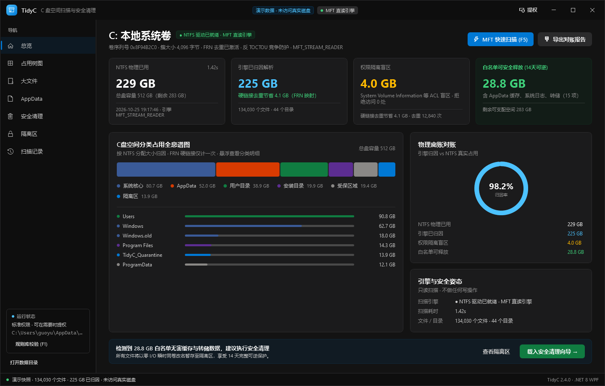
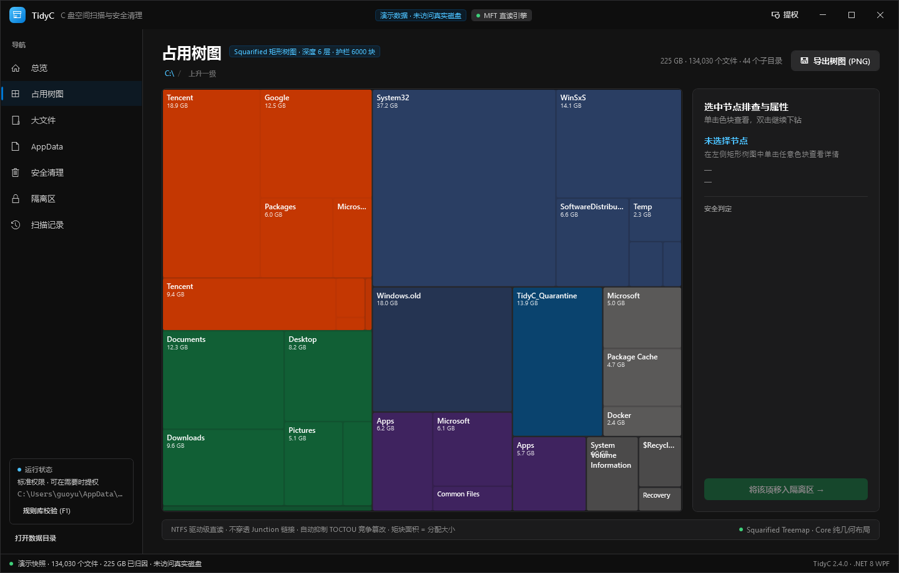
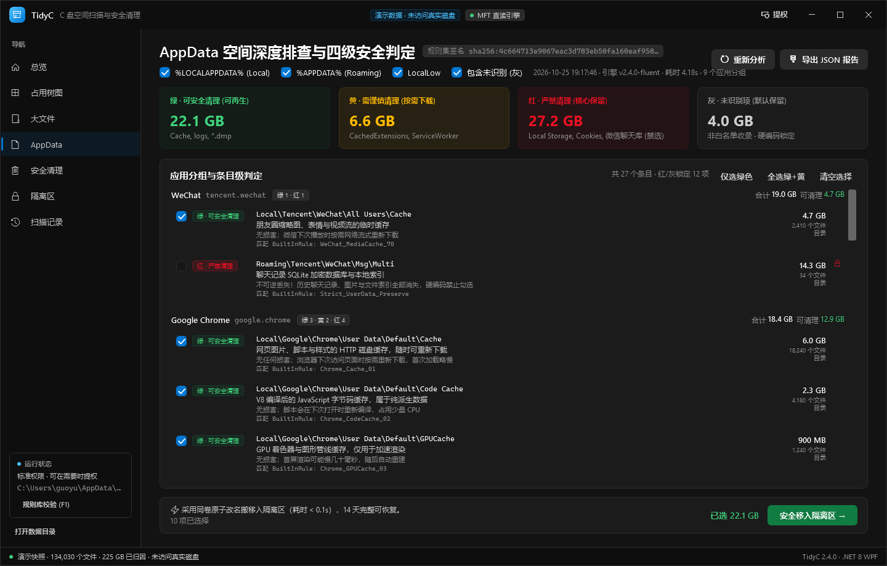
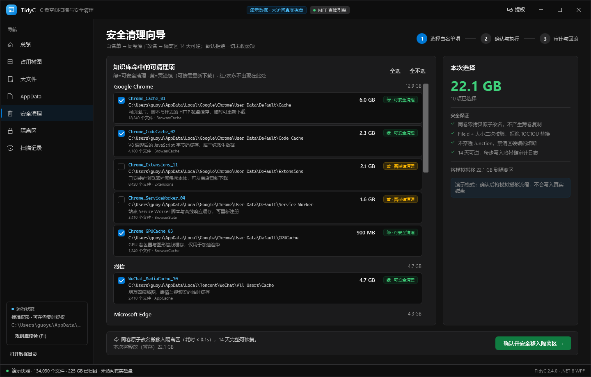
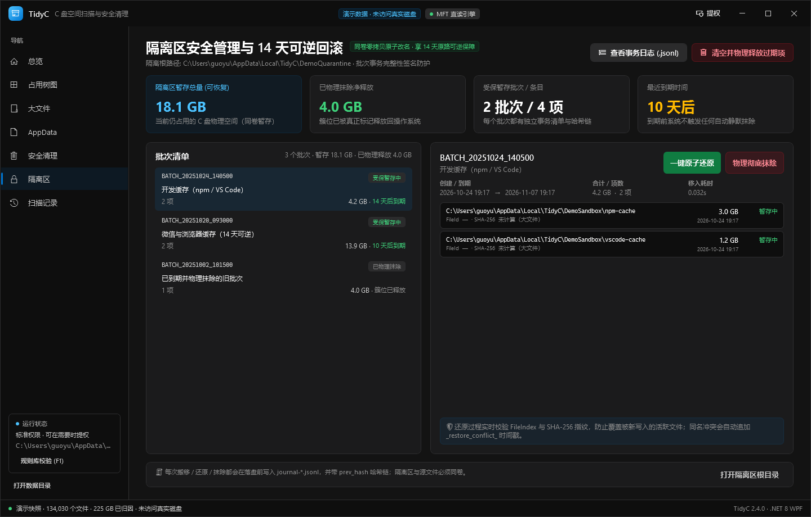

# TidyC — C 盘空间扫描与安全清理（.NET 8 + WPF）

[](https://github.com/guoyu901010/TidyC/actions/workflows/build.yml)
[](https://github.com/guoyu901010/TidyC/releases)

仓库：[github.com/guoyu901010/TidyC](https://github.com/guoyu901010/TidyC) ·
下载：[最新 Release](https://github.com/guoyu901010/TidyC/releases)（`TidyC.exe` 单文件版 / `TidyC-v2.4.0-win-x64.zip`） ·
构建产物：`publish\TidyC.exe`（单文件）、`publish\app\TidyC.exe`（文件夹版）

> 扫出 C 盘被什么占满，并以「白名单 + 四级风险 + 隔离区可恢复」的方式安全清理。
> 默认不删除任何文件：清理 = 同卷零拷贝原子改名到隔离区，14 天内可原路还原。



---

## 1. 六条安全红线如何落地

| 红线 | 实现 | 验证 |
| --- | --- | --- |
| ① 白名单制，默认拒绝 | `Rules/BuiltInRules.cs`（45 条知识库）+ `RuleValidator`（白名单祖先、路径深度、`..`、UNC、禁清区熔断、规则文案完整性、风险冲突、签名） | `RuleValidatorTests`（11 项）；`RuleValidator.EnsureValid` 在启动时失败即禁用清理 |
| ② 删除/移动二次校验（Anti-TOCTOU） | `HandleGuard`：`CreateFileW` 携带 `FILE_FLAG_OPEN_REPARSE_POINT` + `FILE_FLAG_BACKUP_SEMANTICS`；`GetFileInformationByHandleEx(FileIdInfo/FileStandardInfo)` 比对 FileId 与逻辑大小；命中即拒绝并写审计 | `HandleGuardTests`（12 项，含 Junction 替换、FileId 变化、锁定文件、超长路径） |
| ③ 同卷零拷贝原子搬移 | `HandleGuard.MoveVerified` → `MoveFileEx(MOVEFILE_COPY_ALLOWED \| MOVEFILE_REPLACE_EXISTING)`，改名前后用同一句柄复核身份；跨卷直接拒绝 | `QuarantineManagerTests`（13 项，含 < 0.1s 耗时断言） |
| ④ NTFS 物理分配对账 + MFT 直读 | `MftScanner`（`FSCTL_GET_NTFS_VOLUME_DATA` → 顺序读 `$MFT`）、`MftRecordParser`（USA 修复、FILE 魔数、属性链、`$FILE_NAME`、硬链接 FRN 去重、分配大小口径）；无权限自动回退 `DirectoryTreeWalker`（本机实测：MFT 全盘 12s，目录遍历 36s） | `MftRecordParserTests`（17 项对抗样本）、`DirectoryTreeWalkerTests`、`ScanPipelineTests`、`--self-test` 双引擎对拍 |
| ⑤ 权限最小化与官方通道 | `asInvoker` 清单 + 按需 UAC 提权；休眠 `powercfg /h off`、组件 `DISM`、还原点 `vssadmin`、回收站 Shell API、WSL `Optimize-VHD` / `diskpart compact`（绝不手删 vhdx） | `SpecialCleaners` + `WslService`；`--optimize-wsl` 管理员子进程 |
| ⑥ Append-Only 审计 | `AppendOnlyJournal`：JSONL、逐行落盘（WriteThrough）、`seq` + `prev_hash` + 内容 SHA-256 哈希链；搬移/还原/抹除前后各写一条 | `JournalTests`（5 项，含并发、篡改检测、重开续链） |

安全细节：

- 硬编码禁清区：驱动器根、`C:\Windows` 本体与 System32/WinSxS 等、`Program Files*`、用户个人目录（桌面/文档/下载/图片/音乐/视频/OneDrive…，含其它用户配置）、`System Volume Information`、`$Recycle.Bin`、`pagefile.sys` 等。
- `WholeDirectory`（整目录原子搬移）只允许 `C:\Windows.old`。
- 还原前校验 SHA-256 与 FileId；原路径已有新文件时自动改名让位为 `*_restore_conflict_yyyyMMdd_HHmmss`，绝不覆盖。
- 到期批次不会静默删除：只有用户手动「清空过期项」才物理抹除。

---

## 2. 工程结构

```
TidyC.sln
├── src/
│   ├── TidyC.Core/                  # 无 UI 依赖，可独立测试
│   │   ├── Interop/                 # Kernel32 / Shell32 P-Invoke（结构体按原生布局，Pack=4）
│   │   ├── Scan/                    # MftScanner / MftRecordParser / DirectoryTreeWalker
│   │   │                            # FileSystemProbe / TreeOps / SquarifiedTreemap / ScanResult
│   │   ├── Rules/                   # BuiltInRules / RuleValidator / AppDataAnalyzer / CleanupPlanner
│   │   ├── Clean/                   # FileIdentity / HandleGuard / QuarantineManager / SpecialCleaners
│   │   └── Sys/                     # AppendOnlyJournal / ElevationHelper / ProcessRunner / PathKey / ByteSize
│   └── TidyC.App/                   # WPF 客户端（net8.0-windows）
│       ├── Views/                   # MainWindow + 7 大视图
│       ├── ViewModels/              # CommunityToolkit.Mvvm
│       ├── Controls/                # TreemapControl / SpectrumBar / DonutGauge / ProportionBar
│       ├── Converters/  Services/  Styles/  app.manifest（asInvoker + longPathAware + UTF-8）
└── tests/
    ├── TidyC.Core.Tests/            # xUnit 测试（88 项）
    └── TidyC.Core.TestRunner/       # 单进程测试运行器（受限环境后备，见 §4）
```

数据契约：

- 扫描对账：`ScanResult` / `VolumeReconciliation` / `StorageSpectrum`（分配字节口径，附归因率）。
- AppData 四级报告：`appdata-report.json`，字段与枚举严格按 `GREEN/YELLOW/RED/GRAY`（自定义 `RiskLevelConverter`）。
- 隔离批次：`<QuarantineRoot>\BATCH_*\batch.json`（`QuarantineBatch` + `QuarantineRecord`，含 FileId、SHA-256、冲突让位路径）。
- 审计：`journal-batch-move.jsonl` / `journal-batch-restore.jsonl` / `journal-batch-purge.jsonl`。

---

## 3. 构建与运行

需要 Windows 10/11 + .NET 8 SDK（含 WindowsDesktop 运行时）。

```powershell
dotnet build TidyC.sln -c Release
dotnet run --project src/TidyC.App            # 正常启动（首次需点击扫描）
dotnet run --project src/TidyC.App -- --demo  # 演示数据，安全浏览全部视图
```

- 权限：默认 `asInvoker`；MFT 直读与特权清理需要管理员（界面右上角「提权」或自检时 UAC）。
- 隔离区：优先 `C:\TidyC_Quarantine`；若不可写则自动回退到 `%LOCALAPPDATA%\TidyC\Quarantine` 并提示。

---

## 4. 测试

```powershell
dotnet test tests/TidyC.Core.Tests/TidyC.Core.Tests.csproj
```

> 本仓库当前开发容器内 VSTest testhost 无法打开父进程句柄（沙箱限制，报 `Win32Exception (5)`），因此这里用等价的单进程运行器执行同一批 xUnit `[Fact]`：
>
> ```powershell
> dotnet run --project tests/TidyC.Core.TestRunner -- --report artifacts/test-results.json
> ```
>
> 结果：**88 项全部通过**（`artifacts/test-results.json`）。在普通 Windows 上 `dotnet test` 为同源入口。

覆盖：规则校验 11、AppData 四级判定 13、MFT 记录对抗 17、句柄/TOCTOU 12、隔离区生命周期 13、审计日志 5、树图 4、树聚合 4、目录遍历/清理规划 4、双引擎对拍 2、扫描流水线 3（合计 88）。

---

## 5. 双引擎对拍自检（需管理员）

```powershell
# 以管理员身份运行
publish\TidyC.exe --self-test
```

- 顺序读取 `$MFT` vs `DirectoryTreeWalker`，比较文件数/目录数/归因字节，阈值 99.99%。
- 报告写入 `%LOCALAPPDATA%\TidyC\self-test-report.json` 与 exe 同目录。
- 非管理员时退出码 2 并给出提权提示（MFT 直读需要卷句柄）。

---

## 6. 单文件发布

```powershell
dotnet publish src/TidyC.App/TidyC.App.csproj -c Release -r win-x64 --self-contained true `
  -p:PublishSingleFile=true -p:IncludeNativeLibrariesForSelfExtract=true `
  -p:EnableCompressionInSingleFile=true -o publish
```

产物（全部合并在一个目录）：

- `publish\TidyC.exe`（单文件自包含，约 69 MB）
- `publish\TidyC.cmd`（启动器，自动设置可写的单文件解压目录）
- `publish\app\TidyC.exe`（自包含文件夹版，不依赖解压目录，提权最稳）
- `publish\README.txt`（发布目录说明）

```text
publish\
  TidyC.exe      单文件自包含版
  TidyC.cmd      单文件启动器（设置可写解压目录）
  README.txt     发布说明
  app\          自包含文件夹版（app\TidyC.exe + .NET/WPF 运行时）
```

单文件首次运行会把原生库解压到 `%TEMP%\.net`；若该目录不可写（受限容器/组策略），
请双击 `TidyC.cmd`，或改用 `publish\app\TidyC.exe`，也可以手动设置
`DOTNET_BUNDLE_EXTRACT_BASE_DIR` 指向可写目录。

---

## 7. 界面与截图

7 个视图：总览（物理对账 + 分类全息谱图）、占用树图（Squarified 下钻 + PNG 导出）、大文件（Top 100 / Top 50）、AppData（三分支四级清单 + JSON 导出）、安全清理向导（选择 → 确认 → 审计结果）、隔离区（双指标 + 批次还原/抹除）、扫描记录（增量对比 + WSL2 压缩）。

导航性能：页面只在首次访问时布局一次，之后常驻可视树、切换仅调整 Z 序；启动完成后在空闲优先级预热其余页面。
`--screenshot` 日志记录了两轮导航耗时（`artifacts/screens/screenshot.log`），热切换稳定在 **1–6 ms**。

扫描性能（本机 C: 237 GB，详见 `artifacts/scan-benchmarks.md`）：

| 引擎 | 范围 | 耗时 | 说明 |
| --- | --- | --- | --- |
| MFT 直读（管理员） | C:\ 全盘 | **12.1 s** | 解析 `$MFT` 记录 0 的 10 个 data run，分块并行解析 228 万条记录 |
| 目录遍历（普通权限） | C:\ 全盘 | **36.4 s** | 工作窃取队列 + 快速目录枚举 + TopN 阈值预判 |
| 目录遍历（普通权限） | C:\Windows | **10.3 s** | 20.7 万文件 |

扫描期间状态栏实时显示文件数 / 已归因字节 / 耗时，并可「取消扫描」。

演示快照截图（`--demo` 下自动重算，`--screenshot <dir>` 可无头导出）：

| | |
| --- | --- |
|  |  |
|  |  |

---

## 8. 常见问题

| 现象 | 原因与解决 |
| --- | --- |
| 点右上角「提权」没反应 | 已修复：现在会等待管理员实例真正启动。成功时新窗口出现、旧窗口自动关闭；失败会弹出具体原因（UAC 被取消 / 被安全软件拦截 / 单文件解压目录不可写）。单文件版请用 `TidyC.cmd` 启动，或改用 `publish\app\TidyC.exe`。 |
| 单文件版报 `Failed to create default extraction directory` | `%TEMP%` 不可写，改用 `TidyC.cmd` 或 `publish\app\TidyC.exe`。 |
| `--self-test` 退出码 2 | 需要管理员权限（MFT 卷句柄）。 |
| 扫描很慢 | 普通权限会回退目录遍历（全盘约 36 s）；点「提权」后使用 MFT 直读（约 12 s）。扫描中可随时取消。 |
| `dotnet test` 报 Testhost `Win32Exception (5)` | 受限容器的 VSTest testhost 无法打开父进程句柄；用 §4 的单进程运行器。 |

---

## 9. 运行期数据

| 内容 | 位置 |
| --- | --- |
| 隔离批次 / 审计日志 | `C:\TidyC_Quarantine`（不可写时回退 `%LOCALAPPDATA%\TidyC`） |
| 扫描历史 | `%LOCALAPPDATA%\TidyC\scan-history.json` |
| 自检报告 / 崩溃日志 | `%LOCALAPPDATA%\TidyC\self-test-report.json`、`crash.log` |
| 演示沙盒 | `%LOCALAPPDATA%\TidyC\DemoQuarantine`、`DemoSandbox`（与生产隔离区完全分离） |

---

## 10. 已知限制

- MFT 直读/SpecialCleaners/WSL 压缩需要管理员；普通权限自动回退目录遍历（无 FRN 硬链接去重，报告中会标注）。MFT 通过解析 `$MFT` 记录 0 的 data runs 读取全部碎片段，`$BadClus` 等元文件已排除。
- AppData 报告对超大目录设置了每规则条目上限（默认 80）与灰度深度上限，避免 UI 卡顿。
- 大文件（> 64 MB）默认不算 SHA-256（可在 `QuarantineConfiguration.HashSizeLimitBytes` 调整）。
- `dotnet test` 在受限容器内受 VSTest testhost 限制，见 §4。
- WSL 压缩依赖 `Optimize-VHD` 或 `diskpart`，均为官方工具调用，失败会原样返回输出。
